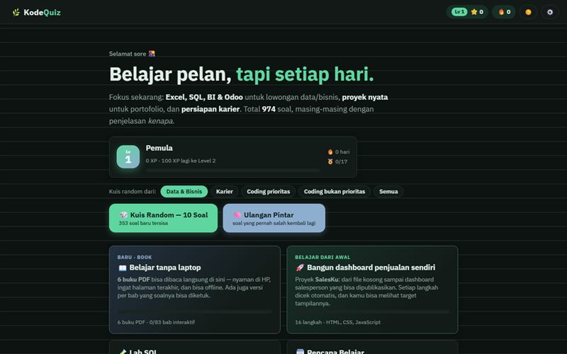

# KodeQuiz

PWA belajar data dan ERP: 974 soal, buku PDF, dan Lab SQL.

**Demo:** https://portofolio-jauza-fawaid.netlify.app/KUIS-KODING/



Website belajar mandiri untuk lulusan Teknik Informatika yang sedang menyiapkan diri untuk lowongan **Data Analyst, BI Analyst, dan ERP/Odoo Consultant**, plus fondasi coding.

**974 soal**, masing-masing dengan penjelasan *kenapa* jawabannya benar. Semuanya berjalan di browser: **tanpa server, tanpa instalasi**, dan **bisa offline**. Progres tersimpan otomatis.

## Fitur

| Fitur | Isi |
|---|---|
| 📊 **Data & Bisnis** | Excel (10 bab), SQL (8 bab), Dashboard & BI (4), Statistik & Metrik (4), ERP & Odoo (5) |
| 💼 **Persiapan Karier** | Portofolio dari skripsi, CV berbasis dampak, kata kunci lowongan, wawancara (STAR), LinkedIn & strategi melamar |
| 💻 **Bahasa pemrograman** | **Prioritas:** SQL → Python → JavaScript. **Bukan prioritas (opsional):** HTML, CSS, Java, PHP. Setiap bahasa diberi label dan alasannya |
| 📖 **Book** | **Rak 6 buku PDF yang dibaca langsung di website** (pembaca PDF bawaan: daftar isi per bab, lompat ke Uji Diri/Kunci, link di PDF bisa diketuk, zoom, mode malam, ingat halaman terakhir, bisa offline). Ada juga versi **interaktif per bab** (soal bisa diketuk & dinilai) dan cetak/simpan PDF sendiri (HP, A5, A4) |
| 🎉 **Perayaan** | Combo jawaban beruntun, layar skor dengan medali, bintang, cincin skor, konfeti & kembang api, transisi tirai, naik level, dan 16 lencana. Suara lembut (bisa dimatikan) |
| 🧪 **Lab SQL** | 18 tantangan query sungguhan (JOIN, CASE, CTE, window function) yang dicek otomatis dengan SQLite di browser |
| 🚀 **Belajar dari Awal** | Proyek **SalesKu** (dashboard penjualan) dalam 16 langkah dengan editor, pratinjau, dan pengecekan otomatis |
| 🗓️ **Rencana Belajar** | 4 minggu inti + 2 minggu lanjutan. Sebagian besar tercentang otomatis |
| 💡 **Petunjuk & 🏳️ Menyerah** | Di setiap soal. Untuk soal Data/Karier/coding baru juga ada *kenapa pilihan lain salah* |
| 🧠 **Ulangan Pintar** | Spaced repetition: soal yang salah kembali lebih sering (termasuk jawaban dari Book) |
| 📱 **PWA & pindah progres** | Bisa di-install ke layar utama HP dan dipakai offline. Progres bisa dipindah laptop ↔ HP lewat ⚙️ Pengaturan |
| 🌙 **Tema tenang** | Palet sage & biru lembut, mode gelap, dan transisi halus antarlayar |

### Jumlah soal

| Topik | Soal | Topik | Soal |
|---|---:|---|---:|
| Excel | 117 | Python ★ | 198 |
| SQL ★ | 84 | JavaScript ★ | 130 |
| Dashboard & BI | 47 | HTML | 61 |
| Statistik & Metrik | 47 | CSS | 111 |
| ERP & Odoo | 58 | Java | 40 |
| Persiapan Karier | 43 | PHP | 38 |

★ = bahasa prioritas. Semua output kode di soal Python, JavaScript, Java, PHP, dan SQL sudah dijalankan sungguhan untuk memastikan kuncinya benar (`node alat/cek-soal.js`).

## Cara menjalankan

**Paling mudah:** buka `index.html` di Chrome/Edge/Firefox (klik dua kali).

**Server lokal** (jika browser membatasi file lokal):

```bash
cd kodequiz
python3 -m http.server 8000      # Windows: python -m http.server 8000
# buka http://localhost:8000
```

**Online gratis:** Netlify → *Add new site → Deploy manually* → seret folder ini. Atau GitHub Pages → *Settings → Pages → Deploy from branch → main / root*.

### Belajar di HP

**Deploy gratis ke Netlify (± 2 menit):**

1. Buka [app.netlify.com](https://app.netlify.com) → login (bisa pakai akun GitHub/Google).
2. *Add new site → Deploy manually* → seret **folder `kodequiz`** (yang berisi `index.html`) ke kotak upload.
3. Tunggu sampai muncul link `https://nama-acak.netlify.app`. Ganti namanya di *Site configuration → Change site name* jika mau.
4. Versi baru? Seret lagi foldernya di tab *Deploys*. (Atau hubungkan ke repo GitHub supaya otomatis update setiap push.)

**Di HP:**

1. Buka link Netlify-mu, lalu pilih menu browser **Tambahkan ke Layar Utama** (Install app).
2. Buka **📖 Book → Simpan semua untuk offline** supaya 6 buku PDF tetap bisa dibaca tanpa internet. Aplikasi, Book interaktif, dan Lab SQL otomatis bisa offline setelah dibuka sekali.
3. Pindahkan progres dari laptop: ⚙️ Pengaturan → *Unduh file progres* atau *Salin kode progres* → buka di HP → *Muat dari file* / *Tempel kode*.

> Pembaca PDF di dalam website butuh alamat web (Netlify, GitHub Pages, atau `python -m http.server`). Jika `index.html` dibuka langsung dengan klik dua kali, Book tetap menyediakan tombol untuk membuka file PDF-nya.

## Struktur folder

```
kodequiz/
├── index.html                  # semua layar aplikasi
├── manifest.webmanifest, sw.js # PWA: install ke HP & mode offline
├── css/style.css               # tema, mode gelap, animasi, tampilan cetak
├── js/
│   ├── app.js                  # inti: navigasi, kuis, skor, beranda, level, pengaturan
│   ├── data/dataset.js         # dataset penjualan, transaksi, data kotor, dll.
│   ├── data/buku-info.js       # jumlah halaman & ukuran tiap PDF (dibuat oleh alat/buat-pdf.py)
│   ├── soal/                   # bank soal + materi
│   │   ├── soal-excel.js  soal-excel-2.js  soal-sql.js  soal-sql-2.js
│   │   ├── soal-bi.js  soal-statistik.js  soal-erp.js
│   │   ├── soal-karier.js  soal-karier-2.js
│   │   ├── soal-python.js  soal-python-2.js  soal-js.js  soal-js-2.js
│   │   └── soal-html.js  soal-css.js  soal-web-2.js  soal-java.js  soal-php.js
│   └── fitur/
│       ├── rayakan.js          # konfeti, suara, tirai, level, lencana
│       ├── buku.js             # Book: daftar isi, mode baca interaktif, cetak/PDF
│       ├── pdf-baca.js         # Book: rak & pembaca buku PDF di dalam website
│       ├── proyek-data.js  proyek-blok.js  proyek.js   # Belajar dari Awal
│       └── sql-lab.js          # Lab SQL
├── buku/                       # 6 PDF siap baca (ukuran layar HP)
├── latihan/
│   ├── latihan-excel-penjualan.xlsx   # tugas praktik Bab 1–10 + kolom cek ✓/✗
│   └── penjualan.csv
├── templates/portofolio/index.html    # template studi kasus 1 halaman
├── ikon/                       # ikon aplikasi
├── alat/                       # skrip perawatan (lihat di bawah)
└── vendor/
    ├── sql-asm.js              # sql.js (SQLite di browser, lisensi MIT)
    └── pdfjs/                  # PDF.js 3.11 (pembaca PDF, lisensi Apache-2.0)
```

## Menambah soal

Tambahkan soal di **akhir** array di `js/soal/` (ID soal = topik + urutan, jadi menyisipkan di tengah akan menggeser progres lama).

```js
{k:"sumifs", t:"mc", lv:2, tb:"penjualan", kode:'=SUMIFS(F2:F11,A2:A11,"Andi")',
 q:"Hasil rumus ini adalah…", o:["A","B","C","D"], a:1,
 e:"Penjelasan kenapa jawabannya B.",
 w:["Kenapa A salah", null, "Kenapa C salah", "Kenapa D salah"],
 h:"Petunjuk opsional"}
```

- Isian: `{k:"dasar", t:"is", lv:1, q:"…", a:["max"], e:"…"}` — tidak peka huruf besar/kecil & spasi, `;` = `,`.
- `k` harus sama dengan salah satu bab di `MATERI_*`. `tb` menampilkan tabel dari `dataset.js`.
- Soal "output kode" bisa diberi `vr:"py"` / `"js"` / `"java"` / `"php"` / `"sql"` agar diverifikasi otomatis.

## Alat perawatan (`alat/`)

| Perintah | Fungsi |
|---|---|
| `node alat/cek-soal.js` | Cek struktur semua soal dan jalankan kode di soal bertanda `vr` |
| `python alat/buat-pdf.py` | Membuat ulang 6 PDF Book + `js/data/buku-info.js` (butuh `pip install playwright pypdf` + `playwright install chromium`). Jalankan setelah menambah soal/materi |
| `python alat/buat-sw.py` | Memperbarui daftar file offline di `sw.js` setelah menambah file |
| `python alat/buat-latihan-excel.py` | Membuat ulang file latihan Excel (butuh `pip install openpyxl`) |

## Catatan

- Progres disimpan di `localStorage` browser. Membersihkan data browser = progres hilang (cadangkan lewat ⚙️ Pengaturan → Unduh file progres).
- Kunci penyimpanan lama (`kodequiz_v2`) dipertahankan, jadi progres dari versi sebelumnya tetap terbawa.
- Excel dengan region Indonesia memakai titik koma (`;`) sebagai pemisah argumen; jawaban isian menerima koma maupun titik koma.
- Efek perayaan otomatis mati jika sistem diatur "kurangi gerakan" (reduce motion), dan bisa dimatikan manual di ⚙️ Pengaturan.

## Lisensi

Kode aplikasi: bebas dipakai untuk belajar. `vendor/sql-asm.js` adalah [sql.js](https://github.com/sql-js/sql.js) (MIT, lihat `vendor/sql.js-LICENSE.txt`). `vendor/pdfjs/` adalah [PDF.js](https://github.com/mozilla/pdf.js) dari Mozilla (Apache-2.0, lihat `vendor/pdfjs/LICENSE.txt`).
