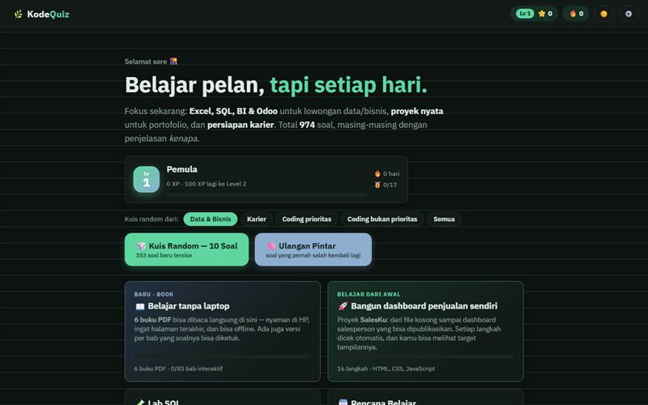

# KodeQuiz

PWA belajar data & keamanan siber: jalur Data Analyst, Data Scientist & Cyber Security, 6.577 soal, 43 tantangan Lab SQL, Lab Coding Test (45 tantangan Python) + 90 Studi Kasus Koding (Python, HTML, CSS, JavaScript, SQL, Odoo), 16 studi kasus, buku PDF.

**Demo:** https://portofolio-jauza-fawaid.netlify.app/KUIS-KODING/



Website belajar mandiri untuk lulusan Teknik Informatika yang sedang menyiapkan diri untuk lowongan **Data Analyst dan Data Scientist** (juga BI Analyst dan ERP/Odoo Consultant), plus fondasi coding.

**6.577 soal**, masing-masing dengan penjelasan *kenapa* jawabannya benar. Semuanya berjalan di browser: **tanpa server, tanpa instalasi**, dan **bisa offline**. Progres tersimpan otomatis.

## Fitur

| Fitur | Isi |
|---|---|
| 🎓 **Jalur Data Analyst** (`#data-analyst`) | 6 tahap, 12 modul (pertanyaan bisnis, metrik, kualitas data, SQL analitik, kohort, membandingkan dengan adil, A/B test, visualisasi, memo, RFM, musiman, dunia kerja), 5 studi kasus, capstone dengan dataset 1.264 transaksi |
| 🔬 **Jalur Data Scientist** (`#data-scientist`) | 5 tahap, 14 modul (CRISP-DM, Bayes, inferensi, pandas, fitur & kebocoran, regresi, klasifikasi, validasi, metrik & ambang, clustering, kausal, MLOps, etika & UU PDP, wawancara), 5 studi kasus, capstone model churn 3.000 pelanggan |
| 🛡️ **Jalur Cyber Security** (`#cyber-security`) | Hacker etis, 7 tahap, 20 modul (etika & hukum, model ancaman, jaringan, Linux, akun & MFA, rekayasa sosial, kriptografi, PKI/TLS, model keamanan web, injeksi, kontrol akses, keamanan sistem, jaringan & Wi-Fi, metodologi pentest, malware, SOC & SIEM, respons insiden & forensik, cloud & DevSecOps, privasi & GRC, karier), 215 soal dengan pembahasan bertingkat (poin penting, cara menjawab, *Ingat*), 6 studi kasus (termasuk Equifax 2017 dan Uber 2016), 7 tantangan Lab SQL analisis log SOC, capstone investigasi insiden 1.160 baris log, dan lembar kunci jawaban PNG HD. Urutan materi dari silabus publik MIT 6.5660 & 6.1600, Harvard CS50 Cybersecurity, Oxford Computer Security & MSc Software and Systems Security |
| 🧮 **Lab Hitung Odoo** (topik ERP & Odoo) | 916 soal angka dari `alat/buat-soal-odoo.py`: pricelist & margin, pajak (PPN 12% DPP 11/12, PPh 23, included/division), satuan UoM, reordering rule & lead time, valuasi FIFO/AVCO, landed cost, durasi & biaya MRP, jurnal & selisih kurs, payment term & cash rounding, penyusutan, pipeline CRM, KPI. Rumus disalin dari kode sumber Odoo 17; pembulatan dicocokkan dengan `float_round` asli Odoo |
| 01 **Lab Hitung Siber** | 1.376 soal hitung yang dibuat program (`alat/buat-soal-siber.py`): biner & heksa, subnetting, port, kode HTTP, encoding (Base64, URL, ROT13), mengenali hash, chmod, sandi Caesar & XOR, entropi password, zona waktu & Unix timestamp di log. Kunci dihitung manual lalu dicocokkan dengan pustaka Python |
| Σ **Problem Set (MIT)** | Penutup tiap tahap: 10 soal campuran tahap ini + tahap sebelumnya, lulus ≥ 70% |
| ✎ **Tutorial (Oxford)** | Tulis jawaban → jawab pertanyaan tutor satu per satu → bandingkan dengan jawaban model → nilai diri dengan rubrik |
| ◆ **Studi kasus (Harvard)** | Situasi kerja Indonesia (perusahaan fiktif, konteks nyata) dan global (Walmart, Zillow, Amazon): exhibit, persiapan, cold call 90 detik, kunci keputusan + alasan, baru diskusi dan catatan pengajar terbuka |
| ◎ **Kunci keyakinan (Mazur)** | Setiap jawaban dikunci dengan Yakin / Ragu / Menebak; yakin-tapi-salah menjadi *titik buta* yang diulang lebih dulu; kalibrasi tampil di Kemajuan. Urutan opsi diacak setiap kali tampil |
| ⇣ **Contoh bertahap** | Di modul jalur: contoh lengkap → lengkapi langkah → mandiri, diperiksa langsung |
| 📈 **Kemajuan** (`#kemajuan`) | Peta aktivitas 16 minggu, progres per tahap, kalibrasi keyakinan, penguasaan per topik, bab terlemah, keputusan kasus, lencana |
| 📊 **Data & Bisnis** | Excel (10 bab), SQL (8 bab), Dashboard & BI (4), Statistik & Metrik (4), ERP & Odoo (31 bab: fungsional, developer, studi kasus konsultan, 12 Lab Hitung Odoo) |
| 💼 **Persiapan Karier** | Portofolio dari skripsi, CV berbasis dampak, kata kunci lowongan, wawancara (STAR), LinkedIn & strategi melamar |
| 💻 **Bahasa pemrograman** | **Prioritas:** SQL → Python (21 bab) → JavaScript (17 bab), ditambah Git & GitHub (4 bab). **Bukan prioritas (opsional):** HTML (9 bab), CSS (12 bab), Java (7 bab), PHP (7 bab). Setiap bahasa diberi label dan alasannya |
| 📖 **Book** | **Rak 8 buku PDF yang dibaca langsung di website** (pembaca PDF bawaan: daftar isi per bab, lompat ke Uji Diri/Kunci, link di PDF bisa diketuk, zoom, mode malam, ingat halaman terakhir, bisa offline). Ada juga versi **interaktif per bab** (soal bisa diketuk & dinilai) dan cetak/simpan PDF sendiri (HP, A5, A4) |
| 🎉 **Perayaan** | Combo jawaban beruntun, layar skor dengan medali, bintang, cincin skor, konfeti & kembang api, transisi tirai, naik level, dan 16 lencana. Suara lembut (bisa dimatikan) |
| 🐍 **Lab Coding Test & Studi Kasus Koding** | Menulis kode sungguhan, dinilai otomatis di browser: Python (Pyodide), JavaScript (Web Worker), HTML/CSS (iframe + gaya terhitung `getComputedStyle`), SQL (SQLite). 922 tes. **Lab**: 45 tantangan (dasar, algoritma, OOP, logika bisnis ala Odoo, otomasi/RPA) + **simulasi coding test 60 menit** (3 soal acak, petunjuk & solusi dikunci). **Studi Kasus Koding**: setiap bab Python, HTML, CSS, JavaScript, SQL, dan Coding Test Odoo disusul contoh terpandu lalu 2–3 soal menulis kode yang makin sulit; soal berikutnya terkunci sampai lulus, solusi tidak ditampilkan sebelum lulus, kesalahan dijelaskan per tes (urutan salah, lupa return, baris error, daftar kekurangan XML/CSV) dan editor bergetar. **Coding Test Besar** setiap 5 bab (13 buah): satu kasus 3 bagian berurutan (A → B → C) |
| 🎯 **Coding Test Odoo Developer** | 10 bab persiapan tes Junior Odoo/Python Developer: strategi & Big-O, jebakan Python, pola algoritma, otomasi data, lalu Odoo 17 (model, compute/constraint, ORM & Command, inheritance & wizard, view XML tanpa attrs, keamanan, cron, tes). Studi kasus Odoo memakai recordset tiruan dan pemeriksa XML/CSV |
| 🧪 **Lab SQL** | 36 tantangan (18 dasar + 18 kasus kerja DA/DS) dalam format tes interview: cerita, skema, hasil yang diharapkan, 3 petunjuk bertahap, **Jalankan** (percobaan) vs **Kumpulkan** (dinilai), tab Solusi dan Riwayat. Dicek otomatis dengan SQLite di browser |
| 🚀 **Belajar dari Awal** | Proyek **SalesKu** (dashboard penjualan) dalam 16 langkah dengan editor, pratinjau, dan pengecekan otomatis |
| 🗓️ **Rencana Belajar** | 4 minggu inti + 2 minggu lanjutan. Sebagian besar tercentang otomatis |
| 🧭 **Petunjuk kode per langkah** | Di Lab dan Studi Kasus Python, setelah petunjuk teks, solusi dibuka sedikit demi sedikit (maks. 6 langkah). Setiap baris diberi komentar bahasa sehari-hari, dan kata baru di langkah itu dijelaskan dari kamus konsep Python |
| 🔤 **Kamus kata koding** | 184 istilah (navbar, dropdown, API, commit, ORM, dll.) dijelaskan singkat dengan bahasa sehari-hari, bisa dicari dan disaring per kelompok; ikut pencarian menu ☰ |
| ⌨️ **Editor ala VS Code** | Tab = satu jorok (4 spasi di Python, 2 di bahasa lain), Backspace di indentasi menghapus satu jorok penuh, Shift+Tab mengurangi jorok. Python dicek langsung saat mengetik: baris yang lupa menjorok setelah `:` diberi garis merah dan tombol merah berisi penjelasannya |
| 🫧 **Bubble Code Runner** | Tombol Run berbentuk bubble yang bisa diseret ke mana saja, panelnya bisa ditarik untuk diubah ukurannya, dan kembali menjadi bubble saat mengklik di luar. Foto bubble bisa diganti dengan foto dari laptop sendiri (disimpan di browser saja, tidak diunggah) |
| 🎨 **Warna & desain latar** | ⚙️ Pengaturan: pemilih warna latar sendiri (kotak gradasi, slider rona, HEX/RGB/HSL) dengan warna teks dan kartu yang dihitung otomatis agar kontras ≥ 7:1, plus 11 desain latar (kertas kotak, buku tulis, halftone, kotak-kotak, cetak biru, kontur, sinar, gradasi, kertas bertekstur, dll.) yang digambar dengan CSS |
| 💡 **Petunjuk & 🏳️ Menyerah** | Di setiap soal. Untuk soal Data/Karier/coding baru juga ada *kenapa pilihan lain salah* |
| 🧠 **Ulangan Pintar** | Spaced repetition: soal yang salah kembali lebih sering (termasuk jawaban dari Book) |
| 📱 **PWA & pindah progres** | Bisa di-install ke layar utama HP dan dipakai offline. Progres bisa dipindah laptop ↔ HP lewat ⚙️ Pengaturan |
| 🎨 **Palet "Holst"** | Sejak 20 November 2026 warna memakai palet pilihan pengguna (`atelier/holst.css`, dimuat terakhir): krem `#F4F1DE` dan pasir `#D4C4A8` di mode terang, navy `#0D1B2A`/`#1B263B` di mode gelap, aksen biru batu `#415A77` dan sage `#778D7A`. Hapus satu baris `<link>` di `index.html` untuk kembali ke tema Studio |
| 👀 **Tema "Studio"** | Tata letak & huruf. Terinspirasi lusion.co dan pangrampangram.com: latar lavender pucat, tinta gelap, biru listrik, huruf besar Instrument Sans, tombol pil, objek 3D (ikon diagram batang) yang dirender sendiri sebagai gambar diam (klik untuk ganti warna), kartu topik bergaya spesimen huruf. Tetap nyaman: kontras teks ±12:1, mode gelap otomatis, tombol **Aa**, pengingat istirahat mata, tanpa WebGL dan tanpa blur latar |
| ♪ **Musik lo-fi** | Lagu belajar orisinal bergaya lo-fi/city pop yang disintesis langsung di browser (Web Audio, tanpa berkas audio). Tombol ♪ di atas, volume di ⚙️ Pengaturan |

### Jumlah soal

| Topik | Soal | Topik | Soal |
|---|---:|---|---:|
| Excel | 234 | Python ★ | 638 |
| Coding Test Odoo Developer | 238 | Git & GitHub | 108 |
| SQL ★ | 169 | JavaScript ★ | 518 |
| Dashboard & BI | 94 | HTML | 272 |
| Statistik & Metrik | 94 | CSS | 380 |
| ERP & Odoo | 1.370 | Java | 138 |
| Persiapan Karier | 86 | PHP | 136 |
| Jalur Data Analyst | 140 | Jalur Data Scientist | 156 |
| Jalur Cyber Security | 430 | Lab Hitung Siber | 1.376 |

★ = bahasa prioritas. Semua output kode di soal Python, JavaScript, Java, PHP, dan SQL sudah dijalankan sungguhan untuk memastikan kuncinya benar (`node alat/cek-soal.js`).

## Cara menjalankan

**Paling mudah:** buka `index.html` di Chrome/Edge/Firefox (klik dua kali).

**Server lokal** (jika browser membatasi file lokal):

```bash
cd kodequiz
python3 -m http.server 8000      # Windows: python -m http.server 8000
# buka http://localhost:8000
```

**Online gratis:** Netlify → *Add new site → Deploy manually* → seret folder ini. Atau GitHub Pages → *Settings → Pages → Deploy from branch → main / root*.

### Belajar di HP

**Deploy gratis ke Netlify (± 2 menit):**

1. Buka [app.netlify.com](https://app.netlify.com) → login (bisa pakai akun GitHub/Google).
2. *Add new site → Deploy manually* → seret **folder `kodequiz`** (yang berisi `index.html`) ke kotak upload.
3. Tunggu sampai muncul link `https://nama-acak.netlify.app`. Ganti namanya di *Site configuration → Change site name* jika mau.
4. Versi baru? Seret lagi foldernya di tab *Deploys*. (Atau hubungkan ke repo GitHub supaya otomatis update setiap push.)

**Di HP:**

1. Buka link Netlify-mu, lalu pilih menu browser **Tambahkan ke Layar Utama** (Install app).
2. Buka **📖 Book → Simpan semua untuk offline** supaya 8 buku PDF tetap bisa dibaca tanpa internet. Aplikasi, Book interaktif, dan Lab SQL otomatis bisa offline setelah dibuka sekali.
3. Pindahkan progres dari laptop: ⚙️ Pengaturan → *Unduh file progres* atau *Salin kode progres* → buka di HP → *Muat dari file* / *Tempel kode*.

> Pembaca PDF di dalam website butuh alamat web (Netlify, GitHub Pages, atau `python -m http.server`). Jika `index.html` dibuka langsung dengan klik dua kali, Book tetap menyediakan tombol untuk membuka file PDF-nya.

## Struktur folder

```
kodequiz/
├── index.html                  # semua layar aplikasi
├── manifest.webmanifest, sw.js # PWA: install ke HP & mode offline
├── css/style.css               # tema, mode gelap, animasi, tampilan cetak
├── js/
│   ├── app.js                  # inti: navigasi, kuis, skor, beranda, level, pengaturan
│   ├── data/dataset.js         # dataset penjualan, transaksi, data kotor, dll.
│   ├── data/buku-info.js       # jumlah halaman & ukuran tiap PDF (dibuat oleh alat/buat-pdf.py)
│   ├── data/jalur.js           # peta jalur DA/DS: tahap, tutorial, capstone, metode belajar
│   ├── data/kasus.js           # 10 studi kasus (metode kasus HBS)
│   ├── soal/                   # bank soal + materi
│   │   ├── soal-excel.js  soal-excel-2.js  soal-sql.js  soal-sql-2.js
│   │   ├── soal-bi.js  soal-statistik.js  soal-erp.js
│   │   ├── soal-karier.js  soal-karier-2.js
│   │   ├── soal-python.js … soal-python-7.js  soal-js.js … soal-js-6.js   # file -3/-4… = tambahan 2x lipat + Pendalaman materi (dimuat setelah file lama agar ID soal tetap)
│   │   ├── soal-html.js  soal-css.js  soal-web-2.js  soal-java.js  soal-php.js
│   │   └── soal-da.js  soal-ds.js  soal-kasus-sql.js   # jalur DA/DS + tantangan Lab kasus kerja
│   │   └── materi-2x-1.js … materi-2x-9.js   # materi 2x lipat semua topik: contoh terpandu, kesalahan umum, latihan + kunci, studi kasus, kamus bab, cek ulang (dimuat paling akhir)
│   └── fitur/
│       ├── rayakan.js          # konfeti, suara, tirai, level, lencana
│       ├── buku.js             # Book: daftar isi, mode baca interaktif, cetak/PDF
│       ├── pdf-baca.js         # Book: rak & pembaca buku PDF di dalam website
│       ├── proyek-data.js  proyek-blok.js  proyek.js   # Belajar dari Awal
│       ├── sql-lab.js          # Lab SQL
│       └── py-lab.js           # Lab Coding Test Python + Studi Kasus Koding (Pyodide di Web Worker)
├── jalur/                      # halaman jalur, kasus, tutorial, kemajuan, navigasi (pakai DOM, sengaja di luar js/)
├── buku/                       # 8 PDF siap baca (ukuran layar HP), termasuk Jalur DA & DS
├── latihan/
│   ├── latihan-excel-penjualan.xlsx   # tugas praktik Bab 1–10 + kolom cek ✓/✗
│   ├── penjualan.csv
│   └── capstone-pasarku.csv  capstone-telkonesia.csv   # dataset capstone (alat/buat-data-capstone.py)
├── templates/portofolio/index.html    # template studi kasus 1 halaman
├── ikon/                       # ikon aplikasi
├── alat/                       # skrip perawatan (lihat di bawah)
└── vendor/
    ├── sql-asm.js              # sql.js (SQLite di browser, lisensi MIT)
    └── pdfjs/                  # PDF.js 3.11 (pembaca PDF, lisensi Apache-2.0)
```

## Menambah soal

Tambahkan soal di **akhir** array di `js/soal/` (ID soal = topik + urutan, jadi menyisipkan di tengah akan menggeser progres lama).

```js
{k:"sumifs", t:"mc", lv:2, tb:"penjualan", kode:'=SUMIFS(F2:F11,A2:A11,"Andi")',
 q:"Hasil rumus ini adalah…", o:["A","B","C","D"], a:1,
 e:"Penjelasan kenapa jawabannya B.",
 w:["Kenapa A salah", null, "Kenapa C salah", "Kenapa D salah"],
 h:"Petunjuk opsional"}
```

- Isian: `{k:"dasar", t:"is", lv:1, q:"…", a:["max"], e:"…"}` — tidak peka huruf besar/kecil & spasi, `;` = `,`.
- `k` harus sama dengan salah satu bab di `MATERI_*`. `tb` menampilkan tabel dari `dataset.js`.
- Urutan opsi diacak saat tampil, jadi kunci boleh di posisi mana pun; jangan menulis opsi yang merujuk huruf ("A dan B").
- `cek-soal.js` juga memeriksa rujukan di `js/data/jalur.js` dan `js/data/kasus.js` (modul, tantangan SQL, kasus, dataset capstone).
- Soal "output kode" bisa diberi `vr:"py"` / `"js"` / `"java"` / `"php"` / `"sql"` agar diverifikasi otomatis.

## Alat perawatan (`alat/`)

| Perintah | Fungsi |
|---|---|
| `node alat/cek-soal.js` | Cek struktur semua soal dan jalankan kode di soal bertanda `vr` |
| `alat/render-3d.html` | Adegan 3D untuk gambar diam. Gambarnya sudah tidak dipakai (dihapus 2026-11-20). Alat ini dibiarkan untuk dipakai lagi nanti. Render: Chrome headless + SwiftShader, `?adegan=hero|da|ds&w=&h=&warna=0..3`, lalu ubah ke WebP |
| `node alat/buat-pdf.js` | Membuat ulang 8 PDF Book + `js/data/buku-info.js` memakai Google Chrome yang sudah terpasang (tanpa paket tambahan; jumlah halaman lewat `pypdf` bila ada). Jalankan setelah menambah soal/materi |
| `python alat/buat-pdf.py` | Cara lama yang sama hasilnya (butuh `pip install playwright pypdf` + `playwright install chromium`) |
| `python -I alat/buat-lab-python.py` | Membuat ulang `js/soal/lab-python.js` dari `alat/buat-lab-python.py` (Lab), `lab-studi-python*.py`, `lab-studi-ct.py`, `lab-studi-html.py`, `lab-studi-css.py`, `lab-studi-js.py`, `lab-studi-sql.py` (studi kasus per bab), dan `lab-ujian.py` (Coding Test Besar Python/Odoo). Python dijalankan CPython, JavaScript dijalankan Node (`alat/uji-js.js`); solusi acuan harus lulus dan kode awal harus gagal. Soal HTML/CSS/SQL diverifikasi di browser dengan `await plUjiSemua()` di konsol |
| `python alat/buat-sw.py` | Memperbarui daftar file offline di `sw.js` setelah menambah file |
| `python alat/buat-latihan-excel.py` | Membuat ulang file latihan Excel (butuh `pip install openpyxl`) |
| `python alat/buat-data-capstone.py` | Membuat ulang dataset capstone jalur DA, DS, dan Cyber (seed tetap) |
| `python alat/buat-soal-odoo.py` | Membuat ulang `js/soal/soal-erp-hitung.js` (Lab Hitung Odoo); memakai `E:\odoo\odoo17` bila ada untuk mencocokkan pembulatan |
| `python alat/buat-soal-siber.py` | Membuat ulang `js/soal/soal-siber.js` (Lab Hitung Siber); berhenti jika hitungan manual berbeda dari pustaka Python |
| `node alat/buat-kunci-gambar.js` | Membuat ulang 60 lembar kunci jawaban Jalur Cyber (PNG 2160 px, folder `kunci/cyber/`, ±21 MB) memakai Chrome terpasang; dikompres dengan Pillow bila ada |

## Catatan

- Progres disimpan di `localStorage` browser. Membersihkan data browser = progres hilang (cadangkan lewat ⚙️ Pengaturan → Unduh file progres).
- Kunci penyimpanan lama (`kodequiz_v2`) dipertahankan, jadi progres dari versi sebelumnya tetap terbawa.
- Excel dengan region Indonesia memakai titik koma (`;`) sebagai pemisah argumen; jawaban isian menerima koma maupun titik koma.
- Efek perayaan otomatis mati jika sistem diatur "kurangi gerakan" (reduce motion), dan bisa dimatikan manual di ⚙️ Pengaturan.

## Lisensi

Kode aplikasi: bebas dipakai untuk belajar. `vendor/sql-asm.js` adalah [sql.js](https://github.com/sql-js/sql.js) (MIT, lihat `vendor/sql.js-LICENSE.txt`). `vendor/pdfjs/` adalah [PDF.js](https://github.com/mozilla/pdf.js) dari Mozilla (Apache-2.0, lihat `vendor/pdfjs/LICENSE.txt`).
